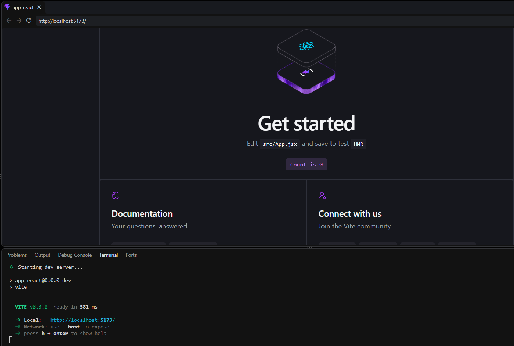
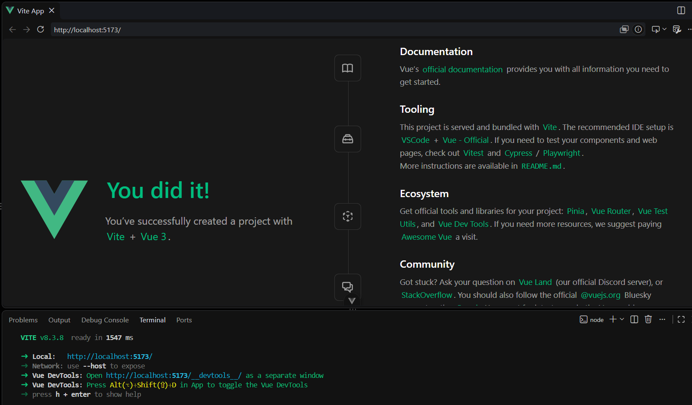
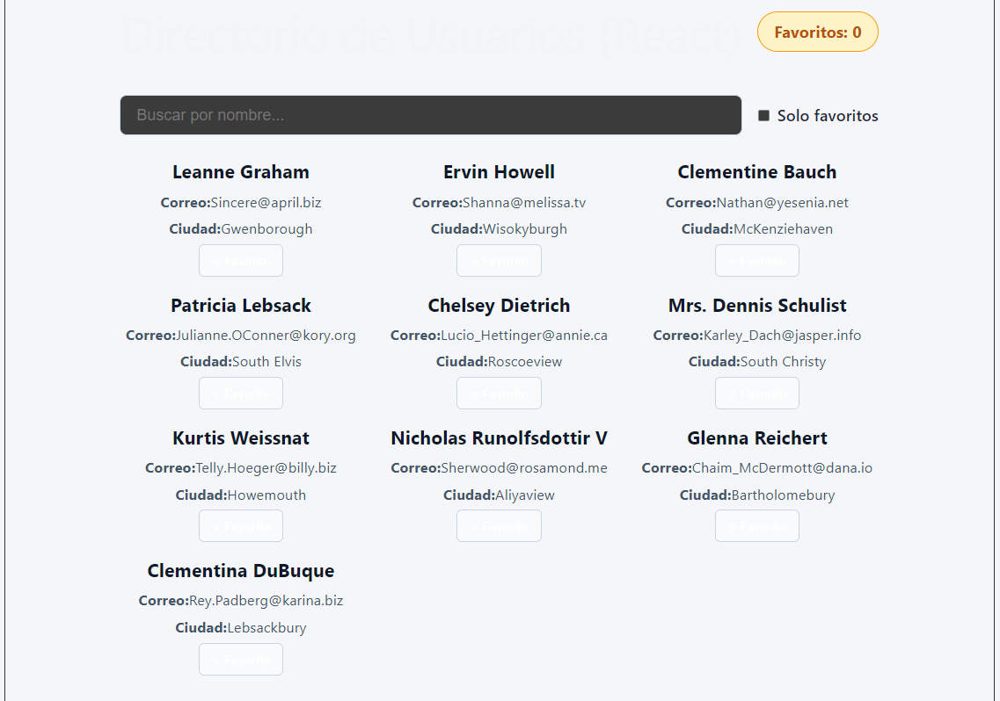
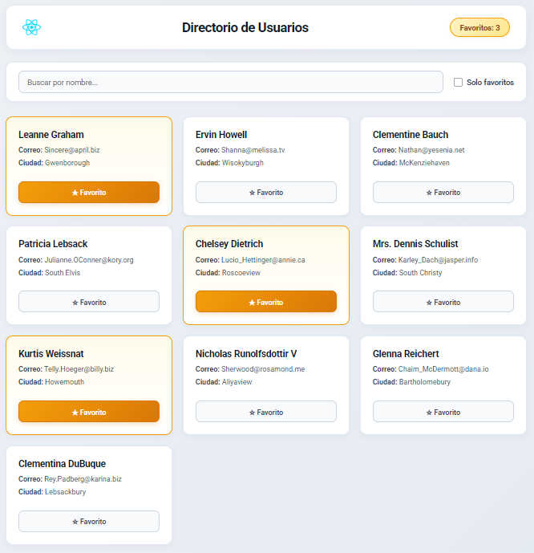
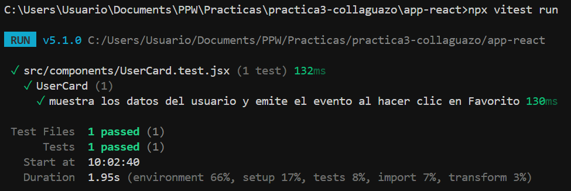
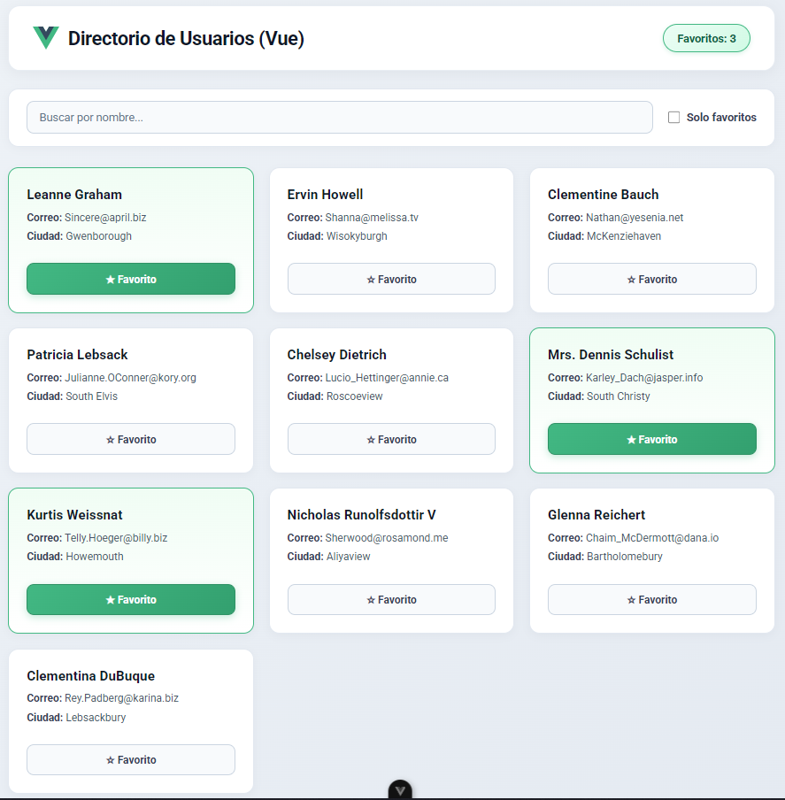
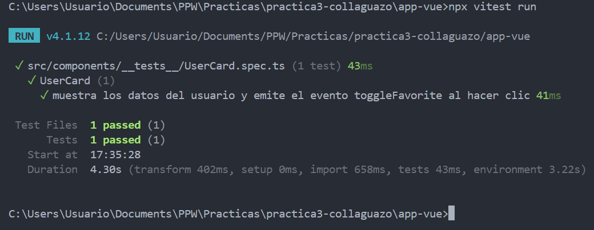

# Práctica 3: Desarrollo Interactivo de Aplicaciones

**Directorio de Usuarios | React y Vue 3**

Práctica desarrollada para la asignatura de Computación, cuyo objetivo es implementar una aplicación web interactiva utilizando dos frameworks de desarrollo frontend: React y Vue 3.

---

## Información del proyecto

| Información | Detalle |
|---|---|
| **Carrera** | Computación |
| **Autor** | Brandon Collaguazo |
| **Práctica** | Práctica 3 |
| **Frameworks** | React y Vue 3 |
| **Herramienta de desarrollo** | Vite |
| **API utilizada** | JSONPlaceholder |

---

## 1. Descripción del proyecto

El proyecto consiste en desarrollar un **Directorio de Usuarios** mediante dos implementaciones independientes: una utilizando React y otra utilizando Vue 3.

Ambas aplicaciones consumen información de la API pública [JSONPlaceholder](https://jsonplaceholder.typicode.com/users), permitiendo visualizar y gestionar usuarios mediante una interfaz interactiva.

### Funcionalidades principales

- **Listado de usuarios:** visualización de tarjetas con nombre, correo electrónico y ciudad.
- **Búsqueda en tiempo real:** filtrado de usuarios por nombre, sin distinguir entre mayúsculas y minúsculas.
- **Gestión de favoritos:** posibilidad de marcar y desmarcar usuarios como favoritos.
- **Contador dinámico:** visualización de la cantidad de usuarios favoritos.
- **Filtro de favoritos:** opción para mostrar únicamente los usuarios marcados.
- **Estados de conexión:** indicadores de carga y mensajes de error ante problemas de conexión o respuestas HTTP.
- **Pruebas unitarias:** validación del renderizado de componentes y la emisión de eventos mediante Vitest.

---

## 2. Tecnologías utilizadas

| Tecnología | Aplicación |
|---|---|
| React | Desarrollo de la primera versión |
| Vue 3 | Desarrollo de la segunda versión |
| TypeScript | Tipado estático en Vue |
| Vite | Entorno de desarrollo y empaquetado |
| Vitest | Ejecución de pruebas unitarias |
| JSONPlaceholder | API para obtener los usuarios |
| CSS | Diseño y presentación de las interfaces |

---

## 3. Estructura del proyecto

El repositorio está organizado en dos directorios independientes, uno para cada implementación.

```text
practica3-collaguazo/
│
├── app-react/
│   ├── src/
│   │   ├── components/
│   │   │   ├── UserCard.jsx
│   │   │   └── UserCard.test.jsx
│   │   ├── services/
│   │   │   └── usersApi.js
│   │   ├── test/
│   │   │   └── setup.js
│   │   ├── App.jsx
│   │   └── App.css
│   └── vite.config.js
│
├── app-vue/
│   ├── src/
│   │   ├── components/
│   │   │   ├── UserCard.vue
│   │   │   └── __tests__/
│   │   │       └── UserCard.spec.ts
│   │   ├── services/
│   │   │   └── usersService.ts
│   │   ├── types/
│   │   │   └── user.ts
│   │   └── App.vue
│   └── vite.config.ts
│
├── images/
│   └── Evidencias del proyecto
│
├── .gitignore
└── README.md
```

---

## 4. Instalación y ejecución

### Requisitos previos

Antes de ejecutar cualquiera de las aplicaciones, es necesario contar con:

- Node.js (versión 18 o superior).
- npm (incluido con Node.js).
- Git (opcional, para clonar el repositorio).

### 4.1 Aplicación desarrollada en React

**Instalar las dependencias:**

```bash
cd app-react
npm install
```

**Iniciar el servidor de desarrollo:**

```bash
npm run dev
```

**Ejecutar las pruebas unitarias:**

```bash
npx vitest run
```

### 4.2 Aplicación desarrollada en Vue 3

**Instalar las dependencias:**

```bash
cd app-vue
npm install
```

**Iniciar el servidor de desarrollo:**

```bash
npm run dev
```

**Ejecutar las pruebas unitarias:**

```bash
npx vitest run
```

---

## 5. Evidencias de funcionamiento

A continuación, se presentan las capturas que documentan el proceso de instalación, desarrollo y ejecución de ambas aplicaciones.

### 5.1 Instalación y configuración inicial

**Configuración del entorno React con Vite**



**Configuración del entorno Vue 3 con Vite**



### 5.2 Aplicación desarrollada en React

**Versión inicial**



**Mejora visual de la interfaz**



**Ejecución de pruebas unitarias**



### 5.3 Aplicación desarrollada en Vue 3

**Interfaz de la aplicación**



**Ejecución de pruebas unitarias**



---

## 6. Comparación de implementaciones

El proyecto permite observar cómo dos frameworks diferentes pueden utilizarse para desarrollar una aplicación con las mismas funcionalidades.

| Característica | React | Vue 3 |
|---|---|---|
| Lenguaje | JavaScript | TypeScript |
| Componentes | JSX | Single File Components |
| Herramienta | Vite | Vite |
| Pruebas | Vitest | Vitest |
| Consumo de API | Implementado | Implementado |

---

## 7. Conclusión

El desarrollo de esta práctica permitió aplicar conocimientos sobre desarrollo frontend mediante React y Vue 3, implementando funcionalidades como consumo de API, gestión de estados, búsqueda dinámica y componentes reutilizables.

Además, permitió comparar ambos frameworks y reforzar la importancia de las pruebas unitarias para verificar el correcto funcionamiento de los componentes.